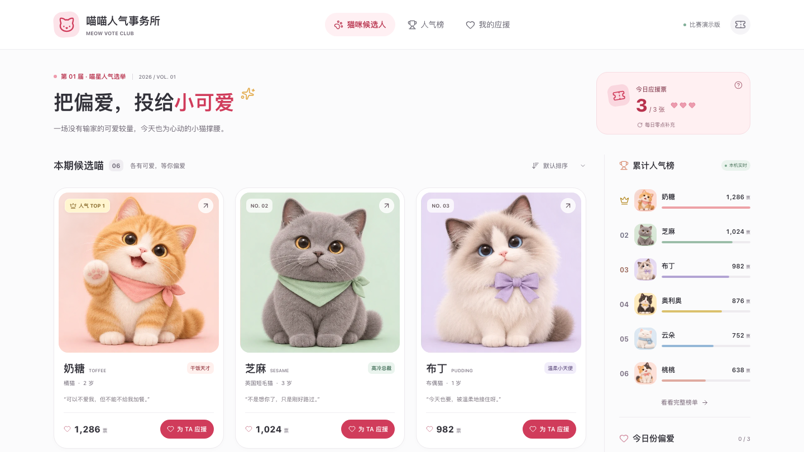

# 喵喵人气事务所

围绕「猫咪 × 投票器 × 可爱圆角风」创作的中文网页 Demo。



源码仓库公开不等于应用已上线；当前未配置公网托管。
预览图来自早期本地演示版，当前功能以源码和下文说明为准。

## 运行

使用 **Node.js 24.x**，后端使用内置 `node:sqlite`。项目保留 `pnpm-lock.yaml`：

```bash
pnpm install --frozen-lockfile --ignore-scripts
pnpm dev --host 127.0.0.1
```

开发服务器集成投票 API，不需要另开后端进程。终端会显示实际访问地址，
默认端口为 5173；已占用时 Vite 自动选择其他端口。

构建并运行完整应用：

```bash
pnpm build
pnpm start
```

默认访问 `http://127.0.0.1:4173`，可通过 `PORT` 修改端口。
数据库默认保存在 `data/votes.sqlite`，可通过 `MEOW_DB` 指定路径。
服务仅监听本机；公开部署、HTTPS、反向代理与生产安全检查需另行配置。

## 构建与验证

```bash
pnpm test
pnpm build
pnpm exec playwright install chromium
pnpm test:browser
TEST_BUILD=1 pnpm test:browser
pnpm audit
```

浏览器测试自行启动隔离服务和内存数据库，不使用日常投票数据库；
`TEST_BUILD=1` 验证构建后的页面，需要先执行 `pnpm build`。
截图和可访问性报告保存在 `test-results/`，不纳入版本管理。

自动化测试覆盖投票规则、服务端事务与跨日、两身份共享榜单、模式隔离、
趣味测试、偏好容错、日历及纪念卡快照。浏览器测试还覆盖多种屏宽、
键盘焦点、PNG 下载和指定 axe WCAG A/AA 规则。

## 体验内容

- 六位原创虚构猫咪候选人，独立肖像、性格、介绍和详情弹窗。
- 每个匿名浏览器身份每天三票，同一只猫咪每天最多一票，服务端校验额度。
- 共享投票模式从零开始，今日与累计双榜按实际记录统计；同票并列、零票不上榜。
- 五道趣味题匹配猫咪性格，可选择、更换或取消本命猫，不自动投票。
- 应援日历、历史回看、累计应援统计与四枚基础徽章。
- 投满三票后显示当日三只猫咪的汇总，不自动弹窗，也不打断猫咪详情。
- 主动生成 900 × 1200 PNG 纪念卡，可选主题和预设宣言、展示本命猫。
- 独立演示模式使用样例历史和票数，可重复体验、确认重置，不写入共享后端。
- 服务端北京时间跨日刷新额度；共享榜单轮询更新，同身份标签页共享投票额度。
- 响应式布局、原生弹窗焦点管理、键盘操作和减少动态效果支持。

## 数据边界

- **共享模式**：使用同一服务的浏览器共享榜单，个人额度与记录属于各自匿名身份。
  会话由服务端签发并通过 HttpOnly Cookie 保存；投票保存在 SQLite，不上传到 GitHub。
- **身份限制**：没有账号登录、恢复码或跨设备个人记录恢复；清除 Cookie 或更换浏览器
  可能获得新身份，不能将每日额度描述为生产级防刷或“一人一份”保证。
- **个人偏好**：趣味测试结果、本命猫和纪念卡偏好仅保存在当前浏览器。
- **演示模式**：5,558 票初始人气及样例历史均为模拟数据，不代表真实用户。
  演示记录和偏好与共享模式隔离，保存在当前标签页的 sessionStorage。
- **旧版记录**：原 localStorage 应援记录只读保留，不自动导入共享榜单。
- **纪念卡**：浏览器本地生成，不上传图片；打开时固定日期、猫咪及个性化快照，
  不作为正式线上投票凭证。

## 素材

- 风格模板：`3D Collectible Toy / 3D 收藏玩具`，`case 378`。
- 提示词：`assets/cat-portraits-prompt.zh.txt`。
- 通过用户指定的 TokenMy 图片技能生成，提交模型名为 `gpt-image-2.5-sunburst`。
- 服务端响应没有 `model` 字段，无法核实实际使用的模型；不将提交参数当成实际模型证明。
- 网站素材：`public/images/`，六张 512 × 512 WebP，总大小约 450KB。
- 生成密钥没有写入项目或前端代码；网页运行时不调用图片 API。
- 生成原图、接口日志和本地设计工作目录未纳入公开仓库；运行所需肖像已包含。
- 界面图标使用 Lucide，按需打包。

## 广东中山提交检查

- 本节链接记录早期本地演示版的提交准备过程，不替代当前共享版的功能说明。
- 平台官方来源与约束：`docs/contest-official-research.md`。
- 当前准备状态、素材和待确认项：`docs/contest-readiness.md`。
- 可用于填表的文案草稿：`docs/submission-copy.md`。
- 已实测官网“广东 / 中山”选项与已锁定的三词命题；尚未上传或提交。
- 当前无公开演示地址；本机地址不能作为外部评委可直接访问的链接。
- 中山专场截止时间、工具与 AI 素材限制仍需主办方确认。

## 文件

```text
index.html             页面结构与规则弹窗
src/cats.js            候选猫咪内容与初始演示票数
src/voting.js          纯投票规则与存储数据校验
src/main.js            交互、弹窗、刷新与导航
src/app-data.js        数据协调、模式切换和偏好隔离
src/data-source.js     共享 API 与演示数据源
src/experience.js      趣味测试、个人偏好、日历与徽章规则
src/experience-views.js 个性化体验的界面模板
src/souvenir.js        应援快照与 Canvas PNG 生成
src/souvenir-dialog.js 纪念卡加载、预览、下载和资源回收
server/                HTTP API、SQLite 存储与应用启动
shared/                服务端日期、榜单和快照模型
public/images/         六张猫咪肖像
tests/                 单元、接口与隔离浏览器测试
SPEC*.md               规格及各模块约定
tasks/                 实现计划和进度记录
```

增强版截图：`outputs/demo-today-ranking.png`、`outputs/demo-completed.png`、
`outputs/demo-souvenir-mobile.png`；实际导出的纪念卡示例为 `outputs/demo-souvenir-card.png`。
